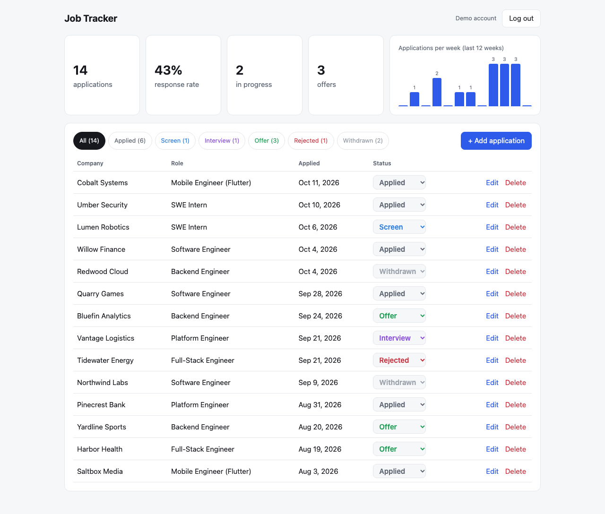

# job-tracker-web

The React + TypeScript front end for [job-tracker-api](https://github.com/Revind4k/job-tracker-api), a Spring Boot / PostgreSQL REST API. Track job applications, change their status inline, and see your response rate and weekly volume.

**Live demo:** https://revind4k.github.io/job-tracker-web/. Click **Try it with sample data** and the app creates a throwaway account with 14 fictional applications, so you don't have to sign up.



## What's in it

- **Auth.** Register and log in against the API's JWT endpoints. The token is kept in `sessionStorage`, not `localStorage`, so it dies with the tab; that limits how long a token stolen by an XSS bug stays useful. Any 401 sends you back to login with a notice, and an expired token is caught before the first request.
- **Dashboard.** Total, response rate, applications in progress, and offers come from `/applications/stats`. A 12-week bar chart fills in empty weeks and aligns to Monday, matching Postgres `date_trunc('week')`.
- **Applications.**
  - Filter chips with counts, and pagination.
  - Add and edit in a native `<dialog>`, which gives focus trapping and Escape handling for free.
  - Delete asks for confirmation first.
  - Validation runs in the browser and shows the server's per-field errors too.
- **Optimistic status changes.** The new status shows immediately and rolls back with an error message if the server refuses.
- **No stale overwrites.** Each list request is tagged, and a response that arrives after a newer request started is dropped. Clicking two filters quickly can't let the slower, older response win. There's a test that fails without this guard.
- **Cold starts.** The API runs on a free tier that sleeps after 15 idle minutes. Instead of looking broken for 30–60 seconds, the app polls the health check with backoff and says it's waking the server up.
- **Responsive and accessible.** Labeled controls, `aria-invalid` on bad fields, a text alternative for the chart, and dark mode. An end-to-end check fails if anything overflows sideways on a phone.

## Tests

| Layer | What | Count |
|---|---|---|
| Unit + component (Vitest, Testing Library) | API client errors (validation, 429 `Retry-After`, network, 401), cold-start polling with fake timers, JWT parsing, week bucketing, and full UI flows: register, CRUD, validation, optimistic rollback, filters, demo seeding, session expiry, and the stale-response race | 21 |
| End to end (Playwright, desktop + Pixel 7) | **A real browser against the real Spring Boot API and PostgreSQL**: register, add with a link, change status, reload and keep the data, delete, wrong password, the demo flow, server-side validation, and no horizontal overflow | 6 |

The component tests run against an in-memory fake of the API built with [MSW](https://mswjs.io). It isn't a stub per test: it enforces the same contract as the real server (JWT auth, per-user isolation, validation errors, stats), so the UI is exercised through real `fetch` calls. CI then runs the end-to-end suite against the actual backend. It checks out `job-tracker-api`, starts it on a Postgres service container, and drives the built site in Chromium.

```bash
npm ci
npm test               # unit + component
npm run e2e            # needs the API on :8080 with CORS_ORIGINS=http://localhost:4173
npm run dev            # http://localhost:5173 (API_URL via VITE_API_URL)
```

## Deployment

- **Front end:** GitHub Pages, built by `.github/workflows/deploy.yml` with `VITE_API_URL` taken from the repository variable `API_URL`.
- **API:** Render's free tier from the API repo's `render.yaml`, which runs without Redis: the rate limiter is off, the cache is in memory, and the health check ignores Redis.
- **Database:** Neon's free Postgres.

MIT License.
